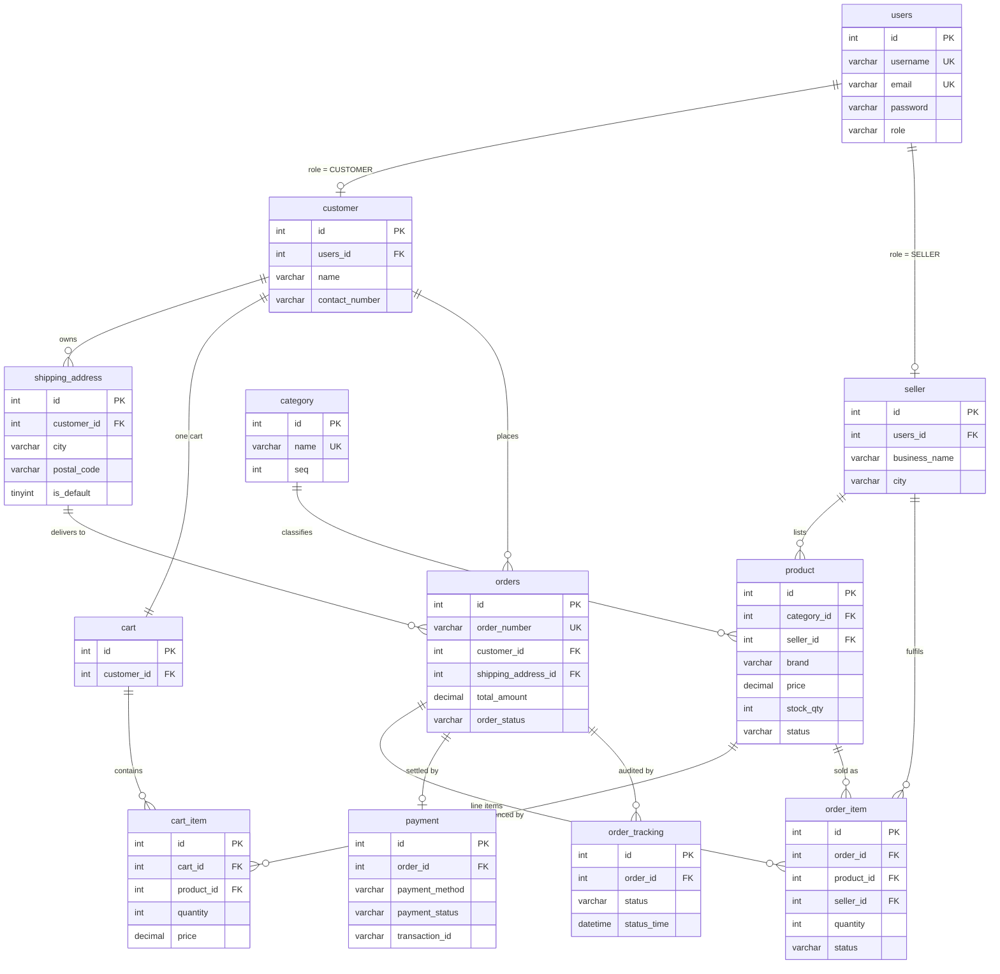

<div align="center">

# QuitQ — E-Commerce Platform

### Database schema, ER model and end-to-end workflow design for a multi-role online marketplace


[Overview](#overview) · [Features](#feature-set) · [Workflow](#end-to-end-workflow) · [Schema](#database-schema) · [Getting Started](#getting-started)

</div>

---

## Overview

**QuitQ** is a full-stack e-commerce marketplace supporting three distinct roles — **Customer**, **Seller** and **Admin** — each with its own dashboard and permission boundary.

This repository captures the **design and persistence layer** of the project:

| Artefact | Purpose |
| :-- | :-- |
| `quitq_ecommerce.sql` | Complete, runnable MySQL 8.0 schema with constraints, triggers and seed data |
| `quitq_ecommerce.mwb` | Editable MySQL Workbench EER model of the same schema |
| `docs/QuitQ - Ecom.pdf` | Project specification and architecture document |
| `docs/E-commerce Registration &-2026-09-25-055625.png` | Full end-to-end workflow diagram across all eight business flows |

The schema is **normalised to 3NF**, fully constrained with foreign keys, and enforces critical business rules (stock validation, inventory decrement, order audit trail) at the database layer through triggers — so invariants hold regardless of what the application code does.

---

## Feature Set

**Flow 1 · Registration & Login**
Role-based sign-up (Customer / Seller), server-side validation, account creation and role-aware login routing into the correct dashboard.

**Flow 2 · Browse & Search**
Keyword search with auto-suggestions, category browsing (Electronics, Mobile, Fashion, Home & Furniture), brand and price filtering, product detail pages and add-to-cart.

**Flow 3 · Cart Management**
Per-customer persistent cart, quantity updates, item removal, live total recalculation and checkout hand-off.

**Flow 4 & 5 · Checkout, Payment & Tracking**
Shipping address entry/selection, payment method choice (Credit Card, Debit Card, UPI, Net Banking, COD), stock re-check at confirmation, order ID generation, and a `Placed → Processing → Shipped → Delivered` status timeline.

**Flow 6 & 7 · Seller Product & Order Processing**
Seller catalogue management (add / edit / mark out-of-stock), plus an orders-received screen with status forwarding.

**Flow 8 · Admin Management**
Analytics report lists, category inventory management (add / modify / remove), and user/seller profile moderation with account removal.

---

## End-to-End Workflow

<p align="center">
  
</p>

<details>
<summary><b>Flow legend</b></summary>

| Flow | Stage | Entry → Exit |
| :-- | :-- | :-- |
| 1 | Registration & Login | Start → role selection → validated account → role-based dashboard |
| 2 | Browse & Search | Search bar / category → filters → product detail → add to cart |
| 3 | Cart Management | View cart → update qty / remove / proceed → live total |
| 4 & 5 | Checkout, Payment & Tracking | Address → payment → confirm → stock re-check → order ID → timeline |
| 6 & 7 | Seller Product & Order Processing | My Products / Orders Received → add, edit, or advance status |
| 8 | Admin Management | Analytics · Manage Categories · Manage Profiles |

</details>

---

## Database Schema

**12 tables**, **3 triggers**, **1 seed dataset** — MySQL 8.0+, InnoDB, `utf8mb4`.



### Business rules enforced by triggers

| # | Trigger | Timing | Guarantee |
| :-- | :-- | :-- | :-- |
| 1 | `trg_check_stock_before_order` | `BEFORE INSERT ON order_item` | Rejects the insert with a `SIGNAL SQLSTATE '45000'` when the product is missing or `stock_qty < quantity` — **no overselling** |
| 2 | `trg_reduce_stock_after_order` | `AFTER INSERT ON order_item` | Atomically decrements `product.stock_qty` and flips `status` to `OUT_OF_STOCK` when it reaches zero |
| 3 | `trg_order_initial_tracking` | `AFTER INSERT ON orders` | Writes the first `order_tracking` row so every order has an audit trail from the moment it is placed |

### Enumerated state models

```
role          : ROLE_CUSTOMER | ROLE_SELLER | ROLE_ADMIN
order_status  : PLACED → PROCESSING → SHIPPED → DELIVERED   (| CANCELLED)
payment_method: CREDIT_CARD | DEBIT_CARD | UPI | NET_BANKING | COD
payment_status: PENDING | COMPLETED | FAILED
product_status : IN_STOCK | OUT_OF_STOCK
```

---

## Getting Started

### Prerequisites

- **MySQL 8.0+** (or MySQL Workbench 8.0+ for the visual model)
- A SQL client — `mysql` CLI, MySQL Workbench, DBeaver, or HeidiSQL

### 1. Clone the repository

```bash
git clone https://github.com/KishoreMuruganantham/QuitQ-Ecommerce.git
cd QuitQ-Ecommerce
```

### 2. Create the database

```bash
mysql -u root -p < quitq_ecommerce.sql
```

Or open `quitq_ecommerce.sql` in MySQL Workbench and run it (⚡ Execute).

### 3. Verify

```sql
USE quitq_db;
SHOW TABLES;                 -- 12 tables
SHOW TRIGGERS;               -- 3 triggers
SELECT role, COUNT(*) FROM users GROUP BY role;
```

Expected: `quitq_db` created with 12 tables and 3 triggers, seeded with 4 users, 2 sellers, 1 customer, 4 categories and 5 products.

### 4. Open the visual model

Open `quitq_ecommerce.mwb` in MySQL Workbench to explore or edit the EER diagram.

---

## Seeded Demo Data

| Role | Username | Email | Notes |
| :-- | :-- | :-- | :-- |
| Admin | `admin` | `admin@quitq.com` | Full analytics & moderation access |
| Seller | `techstore` | `seller1@quitq.com` | TechStore Electronics — Bangalore |
| Seller | `fashionhub` | `seller2@quitq.com` | FashionHub Retail — Mumbai |
| Customer | `john_doe` | `john@example.com` | 1 cart item, 1 saved address (Chennai) |

> Passwords are **BCrypt-formatted placeholders** (`$2a$10$…`). Replace them with real BCrypt hashes before any deployment, and rotate the sample credentials.

---

## Project Structure

```
QuitQ-Ecommerce/
├── README.md                     # This document
├── RELEASE_NOTES.md              # Version history
├── LICENSE                       # MIT License
├── quitq_ecommerce.sql           # Schema, triggers & seed data
├── quitq_ecommerce.mwb           # MySQL Workbench EER model
└── docs/
    ├── QuitQ - Ecom.pdf                              # Project specification
    └── E-commerce Registration &-2026-09-25-055625.png  # Workflow diagram
```

---

## Roadmap

- [ ] Spring Boot REST API layer (JWT authentication, role-based authorisation)
- [ ] React front-end with the three dashboards
- [ ] Order status state machine with optimistic concurrency control
- [ ] Payment gateway integration and webhook handling
- [ ] Unit and integration test suite covering all eight flows
- [ ] CI pipeline with schema migration validation

---

## Author

**Kishore Muruganantham**
GitHub: [@KishoreMuruganantham](https://github.com/KishoreMuruganantham) · Email: kishore.muruganantham@gmail.com

Developed as part of the **Hexaware Technologies Full-Stack Development (FSD) Training** program.

---

## License

Distributed under the **MIT License**. See [`LICENSE`](LICENSE) for full terms.
