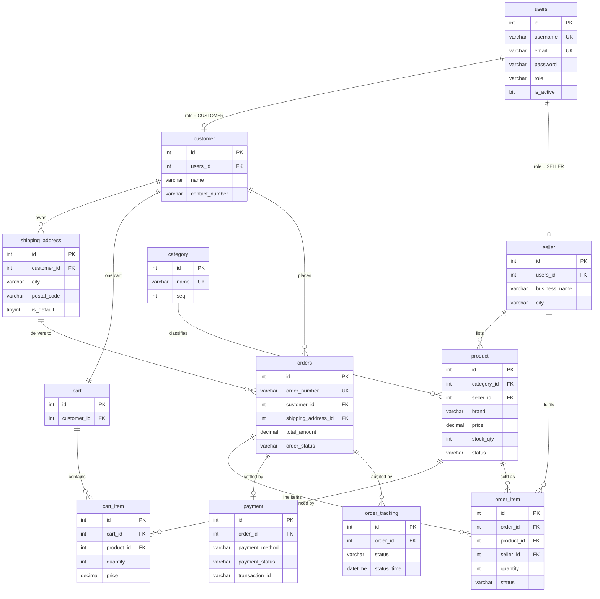

<div align="center">

# QuitQ — E-Commerce Platform

### Spring Boot REST API with MySQL 8.0 schema, ER model and end-to-end workflow design for a multi-role online marketplace


[Overview](#overview) · [API Reference](#api-reference) · [Features](#feature-set) · [Workflow](#end-to-end-workflow) · [Schema](#database-schema) · [Getting Started](#getting-started)

</div>

---

## Overview

**QuitQ** is a full-stack e-commerce marketplace supporting three distinct roles — **Customer**, **Seller** and **Admin** — each with its own dashboard and permission boundary.

This repository captures the **API layer plus the design and persistence layer** of the project:

| Artefact | Purpose |
| :-- | :-- |
| `quitq_backend/` | Spring Boot 3.5 REST API — **47 endpoints** covering all eight business flows |
| `postman/QuitQ-Ecommerce.postman_collection.json` | Postman v2.1 collection — 4 folders, 52 requests, ready to import |
| `quitq_ecommerce.sql` | Complete, runnable MySQL 8.0 schema with constraints, triggers and seed data |
| `quitq_ecommerce.mwb` | Editable MySQL Workbench EER model of the same schema |
| `docs/QuitQ - Ecom.pdf` | Project specification and architecture document |
| `docs/E-commerce Registration &-2026-09-25-055625.png` | Full end-to-end workflow diagram across all eight business flows |

The schema is **normalised to 3NF**, fully constrained with foreign keys, and enforces critical business rules (stock validation, inventory decrement, order audit trail) at the database layer through triggers — so invariants hold regardless of what the application code does. The REST layer sits on top of it with classic controller → service → repository layering, DTO validation and centralised exception handling.

---

## API Reference

Base URL: `http://localhost:8080` — all endpoints are JSON, grouped below exactly as the four Postman folders.

Paged list endpoints (product lists, order history, seller orders, admin customer/seller/user lists) accept optional `page` (default `0`) and `size` (default `20`) query parameters.

### Flow 1 — Auth & Signup

| Method | URL | Result |
| :-- | :-- | :-- |
| GET | `/api/auth/login` | HTTP Basic login → JWT `TokenDto` (`token`, `expiryTime`, `issueTime`) |
| POST | `/api/customer/signup` | Creates user + customer profile (`SignupDto`) |
| GET | `/api/customer/all` · `/api/customer/{id}` | Customer reads |
| DELETE | `/api/customer/{id}` | Remove a customer |
| POST | `/api/seller/signup` | Creates user + seller profile (`SellerDto`) |
| GET | `/api/seller/all` · `/api/seller/{id}` | Seller reads |
| DELETE | `/api/seller/{id}` | Remove a seller |
| POST | `/api/user/add` | Insert a user record (`UserDto`) |
| GET | `/api/user/all` · `/api/user/{id}` | User reads |
| DELETE | `/api/user/{id}` | Remove a user |

### Flow 2 / 6 / 8 — Category & Product

| Method | URL | Result |
| :-- | :-- | :-- |
| POST | `/api/category/add` | Insert a category |
| GET | `/api/category/all` · `/api/category/{id}` | Category reads |
| PUT | `/api/category/{id}` | Update name / description / seq |
| DELETE | `/api/category/{id}` | Remove a category |
| POST | `/api/product/add/{sellerId}` | Seller lists a product (`ProductDto`) |
| GET | `/api/product/all` · `/api/product/{id}` | Product reads |
| GET | `/api/product/brand?brand=Sony` | Derived query — by brand |
| GET | `/api/product/price?min=1000&max=10000` | Derived query — price range |
| GET | `/api/product/search?keyword=shirt` | Derived query — keyword search |
| GET | `/api/product/category/{categoryId}` | Derived query — by category |
| GET | `/api/product/filter` | **Dynamic filter** — `brand`, `categoryId`, `minPrice`, `maxPrice` (all optional) via `(?N IS NULL OR …)` JPQL |
| GET | `/api/product/unpurchased` | **LEFT JOIN JPQL** — products that never appear in an order line (`left join … where oi is null`) |
| PUT | `/api/product/{id}/out-of-stock` | Mark a product out of stock |
| DELETE | `/api/product/{id}` | Remove a product |

### Flow 3 / 4 — Address & Cart

| Method | URL | Result |
| :-- | :-- | :-- |
| POST | `/api/address/add/{customerId}` | Save a shipping address (`ShippingAddressDto`) |
| GET | `/api/address/all/{customerId}` · `/api/address/{id}` | Address reads |
| DELETE | `/api/address/{id}` | Remove an address |
| POST | `/api/cart/add/{customerId}/{productId}?quantity=2` | Add to cart — price snapshotted at add time |
| GET | `/api/cart/{customerId}` | Cart with line items and live total |
| PUT | `/api/cart/item/{cartItemId}?quantity=3` | Update line quantity |
| DELETE | `/api/cart/item/{cartItemId}` | Remove a line |

### Flow 4 / 5 / 7 / 8 — Order, Payment, Seller & Admin

| Method | URL | Result |
| :-- | :-- | :-- |
| POST | `/api/order/checkout/{customerId}/{shippingAddressId}?method=UPI` | **Checkout** - one `@Transactional` method: order + items + payment + stock re-check + cart clear |
| GET | `/api/order/{orderId}` | Order with its items |
| GET | `/api/order/customer/{customerId}` | Order history for a customer |
| GET | `/api/order/{orderId}/tracking` | `order_tracking` timeline |
| GET | `/api/order/seller/{sellerId}` | Seller's order items joined with customer + product |
| PUT | `/api/order/item/{orderItemId}/status?status=SHIPPED` | Advance an order item status |
| POST | `/api/payment/{orderId}/complete?txnId=TXN12345` | Mark the payment completed |
| GET | `/api/admin/analytics/orders-by-status` | `GROUP BY` status counts |
| GET | `/api/admin/users/count` · `/api/admin/sellers/count` | Head-count analytics |

### Validation & Error Handling

Request bodies are **record DTOs carrying Jakarta Bean Validation** annotations (`@NotBlank`, …) and enter the controllers behind `@Valid`. A single `@ControllerAdvice` — `GlobalExceptionHandler` — converts every failure into a structured HTTP 400:

| Exception | Raised when | Response body |
| :-- | :-- | :-- |
| `ResourceNotFoundException` | Unknown id (e.g. `GET /api/product/9999`) | `ErrorDto` — `message`, `comments`, `timestamp` |
| `MethodArgumentNotValidException` | Empty/missing DTO fields | `field → message` map |
| `InvalidCallException` | Malformed call | `ErrorDto` |
| `InsufficientStockException` | Checkout quantity exceeds `stock_qty` | `ErrorDto` |
| `DuplicateEntryException` | Signup with a taken username/email | `ErrorDto` |

The database enforces the rest: `trg_check_stock_before_order` refuses to insert an order line that would oversell, so a rejected checkout **rolls back completely** — no partial order, no payment row.

---

## Authentication & Authorisation

Spring Security is wired the way the trainer's module teaches it:

- **`SecurityConfig`** — a `SecurityFilterChain` with **38 request matchers** (open signups and catalogue reads first, then role rules) plus `.anyRequest().permitAll()`, `csrf` disabled and `httpBasic` enabled. A `DaoAuthenticationProvider` pairs `BCryptPasswordEncoder` with `MyUserDetailsService`, which loads a user only when `users.is_active = 1`.
- **Login** — `GET /api/auth/login` with an HTTP Basic header returns `TokenDto` (`token`, `expiryTime`, `issueTime`). The JWT (HS256, 24-hour expiry, subject = username) is minted by `JwtUtility`.
- **`JwtFilter`** — a `OncePerRequestFilter` registered before Spring's `UsernamePasswordAuthenticationFilter`; it reads `Authorization: Bearer <token>`, validates it, loads the user and pushes the `Role` authorities into the `SecurityContext`.
- **Role rules** — signups, the user bootstrap and all catalogue/category reads stay open; cart, address, checkout, payment and customer reads require `ROLE_CUSTOMER`; product mutations and the seller order screens require `ROLE_SELLER`; analytics, user/seller management and category management require `ROLE_ADMIN`.
- **Ownership checks** — every customer/seller-scoped service method also receives the authenticated `Principal`'s username and verifies the target resource belongs to that user; a mismatch raises `OwnershipException` → HTTP 400 `ErrorDto`, the same error shape as the rest of the API.

---

## Feature Set

**Flow 1 · Registration & Login**
Role-based sign-up (Customer / Seller) with **BCrypt**-hashed passwords, **HTTP Basic** login issuing a **JWT**, and role- plus ownership-checked access on every protected API.

**Flow 2 · Browse & Search**
Keyword search with auto-suggestions, category browsing (Electronics, Mobile, Fashion, Home & Furniture), brand and price filtering, product detail pages and add-to-cart.

**Flow 3 · Cart Management**
Per-customer persistent cart, quantity updates, item removal, live total recalculation and checkout hand-off.

**Flow 4 & 5 · Checkout, Payment & Tracking**
Shipping address entry/selection, payment method choice (Credit Card, Debit Card, UPI, Net Banking, COD), stock re-check at confirmation, order ID generation, and a `Placed → Processing → Shipped → Delivered` status timeline.

**Flow 6 & 7 · Seller Product & Order Processing**
Seller catalogue management (add / edit / mark out-of-stock), plus an orders-received screen with status forwarding.

**Flow 8 · Admin Management**
Analytics report lists, category inventory management (add / modify / remove), and user/seller profile moderation with account removal.

---

## Architecture

```
HTTP  ─▶  Spring Security (JwtFilter + 38 role rules)  ─▶  Controller  ─▶  Service  ─▶  Repository (JpaRepository + JPQL)  ─▶  MySQL 8
                                                             @RestController  @Service     derived queries / @Query / group-by
              │               │
              ▼               ▼
         DTO in (@Valid)   @Transactional checkout
         DTO out (mapper)  custom exceptions
                                │
                                ▼
                    GlobalExceptionHandler (@ControllerAdvice) → HTTP 400
```

| Piece | Count | Notes |
| :-- | :-- | :-- |
| Controllers | 11 | 47 endpoints, no class-level `@RequestMapping` |
| Services | 11 | Business rules; checkout is a single `@Transactional` method |
| Repositories | 12 | Derived queries plus four JPQL `@Query` methods — dynamic filter, seller join, group-by stats, LEFT JOIN unpurchased lookup |
| Entities | 12 | Mapped onto the existing tables (`@Table(name = "users")` etc.) |
| DTOs | 22 | `record` types — request (`*Dto`) and response (`*RespDto` / `*InfoDto` / `*StatDto`) |
| Mappers | 7 | Static entity ↔ DTO conversion |
| Enums | 5 | `Role`, `ProductStatus`, `OrderStatus`, `PaymentMethod`, `PaymentStatus` |
| Exceptions | 4 + handler | Custom exceptions (incl. `OwnershipException`) + `GlobalExceptionHandler` |
| Security | 38 matchers | `SecurityFilterChain`, BCrypt passwords, JWT login (`JwtFilter` / `JwtUtility`), ownership checks |
| Tests | 14 | Mockito unit tests across five service classes (`@ExtendWith(MockitoExtension.class)`) |

> Catalogue reads are open to every caller (`permitAll`); write endpoints need a JWT with the matching role, and every customer/seller operation is additionally checked against the token's owner.

---

## End-to-End Workflow

<p align="center">
  
</p>

<details>
<summary><b>Flow legend</b></summary>

| Flow | Stage | Entry → Exit |
| :-- | :-- | :-- |
| 1 | Registration & Login | Start → role selection → validated account → role-based dashboard |
| 2 | Browse & Search | Search bar / category → filters → product detail → add to cart |
| 3 | Cart Management | View cart → update qty / remove / proceed → live total |
| 4 & 5 | Checkout, Payment & Tracking | Address → payment → confirm → stock re-check → order ID → timeline |
| 6 & 7 | Seller Product & Order Processing | My Products / Orders Received → add, edit, or advance status |
| 8 | Admin Management | Analytics · Manage Categories · Manage Profiles |

</details>

---

## Database Schema

**12 tables**, **3 triggers**, **1 seed dataset** — MySQL 8.0+, InnoDB, `utf8mb4`.



### Business rules enforced by triggers

| # | Trigger | Timing | Guarantee |
| :-- | :-- | :-- | :-- |
| 1 | `trg_check_stock_before_order` | `BEFORE INSERT ON order_item` | Rejects the insert with a `SIGNAL SQLSTATE '45000'` when the product is missing or `stock_qty < quantity` — **no overselling** |
| 2 | `trg_reduce_stock_after_order` | `AFTER INSERT ON order_item` | Atomically decrements `product.stock_qty` and flips `status` to `OUT_OF_STOCK` when it reaches zero |
| 3 | `trg_order_initial_tracking` | `AFTER INSERT ON orders` | Writes the first `order_tracking` row so every order has an audit trail from the moment it is placed |

### Enumerated state models

```
role          : ROLE_CUSTOMER | ROLE_SELLER | ROLE_ADMIN
order_status  : PLACED → PROCESSING → SHIPPED → DELIVERED   (| CANCELLED)
payment_method: CREDIT_CARD | DEBIT_CARD | UPI | NET_BANKING | COD
payment_status: PENDING | COMPLETED | FAILED
product_status : IN_STOCK | OUT_OF_STOCK
```

---

## Getting Started

### Prerequisites

- **JDK 21**
- **MySQL 8.0+** (or MySQL Workbench 8.0+ for the visual model)
- Nothing else — the Maven wrapper (`mvnw`) downloads every dependency

### 1. Clone the repository

```bash
git clone https://github.com/KishoreMuruganantham/QuitQ-Ecommerce.git
cd QuitQ-Ecommerce
```

### 2. Create the database

```bash
mysql -u root -p < quitq_ecommerce.sql
```

Or open `quitq_ecommerce.sql` in MySQL Workbench and run it (⚡ Execute).

### 3. Check the datasource

`quitq_backend/src/main/resources/application.properties` ships with:

```properties
spring.datasource.url=jdbc:mysql://localhost:3306/quitq_db?createDatabaseIfNotExist=true
spring.datasource.username=root
spring.datasource.password=deepcoder
```

Adjust the username/password if yours differ — `createDatabaseIfNotExist=true` covers the database itself.

### 4. Run the API

```powershell
cd quitq_backend
.\mvnw.cmd spring-boot:run        # Windows
```

```bash
cd quitq_backend
./mvnw spring-boot:run            # macOS / Linux
```

Wait for `Started QuitqBackendApplication` (about 40–50 seconds on first boot while Hibernate maps the entities onto the existing tables).

### 5. Verify it is live

Open a GET endpoint straight in the browser:

```
http://localhost:8080/api/category/all
http://localhost:8080/api/product/all
```

Both return the seeded rows as JSON. (Opening `http://localhost:8080` itself shows Spring's Whitelabel 404 — there is no UI at the root, only the API.)

Stop the app with `Ctrl+C`.

### 6. Optional — visual model

Open `quitq_ecommerce.mwb` in MySQL Workbench to explore or edit the EER diagram.

---

## Seeded Demo Data

| Role | Username | Password | Email | Notes |
| :-- | :-- | :-- | :-- | :-- |
| Admin | `admin` | `admin@123` | `admin@quitq.com` | Full analytics & moderation access |
| Seller | `techstore` | `techstore@123` | `seller1@quitq.com` | TechStore Electronics — Bangalore (seller 1) |
| Seller | `fashionhub` | `fashionhub@123` | `seller2@quitq.com` | FashionHub Retail — Mumbai (seller 2) |
| Customer | `john_doe` | `john@123` | `john@example.com` | Customer 1 — 1 cart item, 1 saved address (Chennai) |

> Passwords are stored as **BCrypt hashes** (`$2a$10$…`) and verified by Spring Security's `DaoAuthenticationProvider`; only rows with `users.is_active = 1` can log in. Every signup encodes its password on the way in.

### Suggested demo walkthrough

Run the collection folders in this order — the story reads end-to-end:

1. Run the **three login requests** (HTTP Basic) — each stores its JWT in `customerToken` / `sellerToken` / `adminToken` — then trigger the **duplicate signup** and **empty-field** error scenarios.
2. **Browse** the catalogue: search, brand/price queries, then the **dynamic filter**.
3. **Add an address** and **add items to the cart** (note the price snapshot).
4. Check `GET /api/product/1` → **checkout** with `method=UPI` → check the stock again: `25 → 22` (trigger-driven), then read the **tracking timeline** and complete the **payment**.
5. Show the **failure path**: cart 999 units of a product that has 10 → checkout returns `Insufficient stock` and **rolls back** cleanly.
6. **Seller** order items + status update (`status=SHIPPED`), then the **admin** group-by analytics.

---

## Trying the API — Postman

- **Import**: `postman/QuitQ-Ecommerce.postman_collection.json` into Postman (v2.1 format), or open the shared **QuitQ Ecommerce APIs** collection in your Postman workspace.
- **4 folders / 52 requests** mirroring the flow tables above, with a collection variable `baseUrl = http://localhost:8080`, seeded credentials in the descriptions, and three dedicated error-scenario requests.
- Run the **three login requests first** — each uses HTTP Basic and saves its JWT to a collection variable (`customerToken`, `sellerToken`, `adminToken`); every protected request then sends `Authorization: Bearer {{…}}`.
- The open GETs (catalogue, categories) can still be pasted straight into the browser address bar; the rest need a token from the matching login.

---

## Project Structure

```
QuitQ-Ecommerce/
├── README.md                        # This document
├── RELEASE_NOTES.md                 # Version history
├── LICENSE                          # MIT License
├── quitq_ecommerce.sql              # Schema, triggers & seed data
├── quitq_ecommerce.mwb              # MySQL Workbench EER model
├── quitq_backend/                   # Spring Boot REST API
│   ├── pom.xml                      # Java 21 · Spring Boot 3.5.16
│   └── src/main/
│       ├── resources/application.properties   # datasource config
│       └── java/com/springboot/quitq/
│           ├── controller/          # 11 controllers · 47 endpoints
│           ├── service/             # business rules + @Transactional checkout
│           ├── repository/          # JpaRepository, JPQL, derived queries
│           ├── model/               # 12 entities
│           ├── dto/                 # 22 request/response records
│           ├── mapper/              # static entity ↔ DTO mappers
│           ├── enums/               # Role, OrderStatus, Payment*, ProductStatus
│           ├── exception/           # custom exceptions
│           ├── config/              # GlobalExceptionHandler
│           └── QuitqBackendApplication.java
├── postman/
│   └── QuitQ-Ecommerce.postman_collection.json   # 4 folders · 52 requests
└── docs/
    ├── QuitQ - Ecom.pdf                              # Project specification
    └── E-commerce Registration &-2026-09-25-055625.png  # Workflow diagram
```

---

## Roadmap

- [x] MySQL 8.0 schema, ER model, constraints and business-rule triggers
- [x] Spring Boot REST API covering all eight flows — layering, JPQL, validation, global exception handling
- [x] Postman collection for every endpoint, with error scenarios
- [x] JWT authentication, BCrypt passwords and role/ownership authorisation (Spring Security)
- [ ] API documentation with Swagger / OpenAPI
- [ ] Request logging and correlation ids
- [ ] React front-end with the three dashboards
- [ ] Order status state machine with optimistic concurrency control
- [ ] Payment gateway integration and webhook handling
- [x] Unit tests with Mockito — 14 tests across five service classes
- [ ] CI pipeline with schema migration validation

---

## Author

**Kishore Muruganantham**
GitHub: [@KishoreMuruganantham](https://github.com/KishoreMuruganantham) · Email: kishore.muruganantham@gmail.com

Developed as part of the **Hexaware Technologies Full-Stack Development (FSD) Training** program.

---

## License

Distributed under the **MIT License**. See [`LICENSE`](LICENSE) for full terms.
